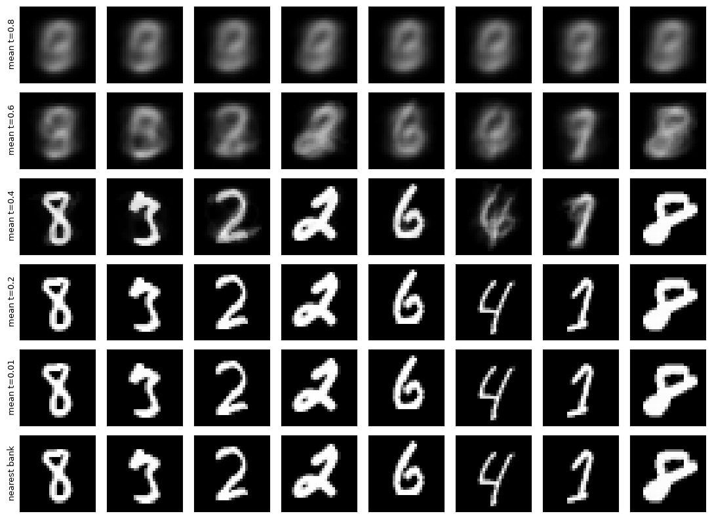
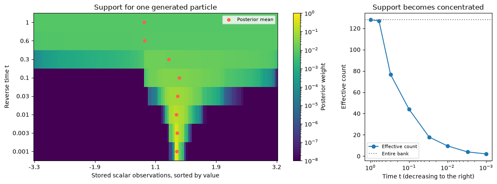
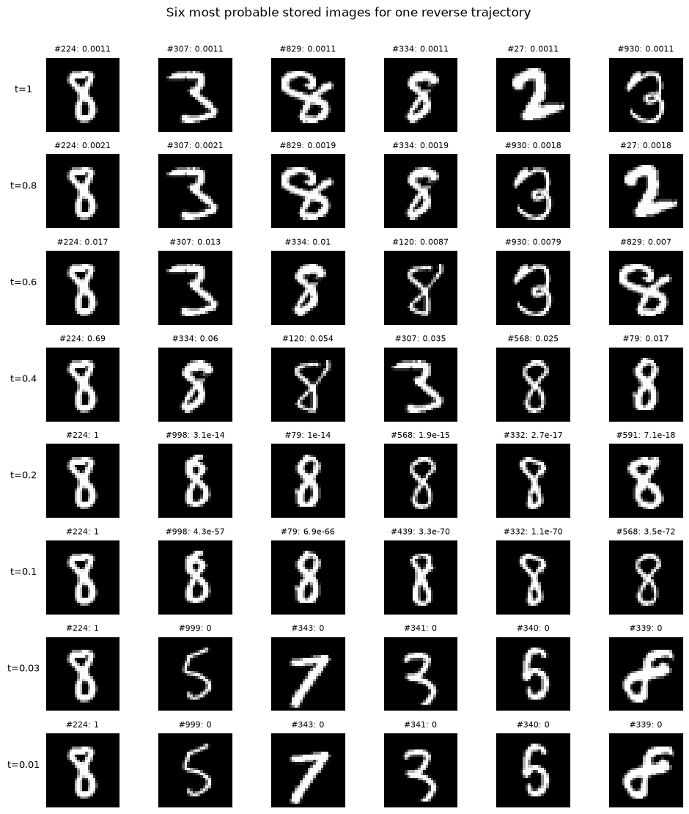

# 07 · Empirical-score sampling {.unnumbered}

::: {.callout-note}
## Draft — Exact denoising, interpolation, and retrieval

[Part 06](./35-probability-flow-ode-part-6.qmd) trained a neural network to estimate a mixture score. Here we keep the sampling problem and evaluate the corrupted empirical score exactly from stored observations. The posterior mean is a softmax-weighted interpolation in the original sample space. We derive the scalar and vector formulas, integrate the probability-flow ODE, inspect which observations support a trajectory, and compare interpolation with retrieval as noise decreases.

The learning objectives are to derive an empirical score without training, use it in backward-time Euler sampling, and explain a denoised estimate through its posterior weights. The one-dimensional and MNIST notebooks provide executed examples. Keep data at $t=0$ and the terminal prior at $t=1$, as in the earlier parts.
:::

[**One-dimensional notebook**](../materials/probability-flow/notebooks/06-empirical-score-1d.html) · [Download `.ipynb`](../materials/probability-flow/notebooks/06-empirical-score-1d.ipynb)

[**MNIST notebook**](../materials/probability-flow/notebooks/07-empirical-score-mnist.html) · [Download `.ipynb`](../materials/probability-flow/notebooks/07-empirical-score-mnist.ipynb)

## 1. The empirical distribution gives an exact score model

Use $n$ for the number of observations and $d$ for their dimension. We first derive the scalar formula, then repeat the steps for vectors. Both derivations apply at positive noise, $\sigma_t>0$, with the same VP amplitudes $\sigma_t^2=1-\alpha_t^2$.

### 1.1. One dimension: from the Gaussian mixture to softmax

Suppose we observe scalars $x_1,\ldots,x_n$. Introduce a uniformly sampled observation index $I$ and set $X_0=x_I$:

$$\Pr(I=i)=\frac1n,\qquad
\widehat P_0=\frac1n\sum_{i=1}^n\delta_{x_i}.$$

Each observed index has mass $1/n$; repeated values combine their masses. This empirical distribution is a model we can sample exactly, not a claim that the unknown population distribution is discrete.

Under VP corruption,

$$X_t=\alpha_tX_0+\sigma_t\varepsilon,\qquad
\varepsilon\sim\mathcal N(0,1),$$

with $\varepsilon$ independent of $I$. Conditional on the index, the Gaussian density is

$$\phi_i(x,t)=p_t(x\mid I=i)
=\frac1{\sqrt{2\pi\sigma_t^2}}
\exp\left[-\frac{(x-\alpha_tx_i)^2}{2\sigma_t^2}\right].$$

Average over the indices to obtain the marginal density:

$$\boxed{\widehat p_t(x)=\sum_{i=1}^n\Pr(I=i)\phi_i(x,t)
=\frac1n\sum_{i=1}^n\phi_i(x,t).}$$

Differentiating one component gives

$$\partial_x\phi_i(x,t)
=\phi_i(x,t)\,\partial_x
\left[-\frac{(x-\alpha_tx_i)^2}{2\sigma_t^2}\right]
=\phi_i(x,t)\frac{\alpha_tx_i-x}{\sigma_t^2}.$$

Now differentiate the finite sum and divide by its density:

$$\begin{aligned}
\widehat s_t(x)
&=\partial_x\log\widehat p_t(x)
=\frac{\partial_x\widehat p_t(x)}{\widehat p_t(x)}\\
&=\frac{\frac1n\sum_i\phi_i(x,t)(\alpha_tx_i-x)/\sigma_t^2}
{\frac1n\sum_j\phi_j(x,t)}\\
&=\sum_i\frac{\phi_i(x,t)}{\sum_j\phi_j(x,t)}
\frac{\alpha_tx_i-x}{\sigma_t^2}.
\end{aligned}$$

Define the normalized component weights

$$w_i(x,t)=\frac{\phi_i(x,t)}{\sum_j\phi_j(x,t)}.$$

All components have the same Gaussian normalizing factor, so it cancels. With logits

$$\ell_i(x,t)=-\frac{(x-\alpha_tx_i)^2}{2\sigma_t^2},$$

the weights become exactly a softmax over the $n$ observation indices:

$$\boxed{w_i(x,t)=\frac{e^{\ell_i(x,t)}}{\sum_{j=1}^n e^{\ell_j(x,t)}}
=\operatorname{softmax}_i(\ell_1(x,t),\ldots,\ell_n(x,t)).}$$

Bayes' rule identifies what these weights mean:

$$\Pr(I=i\mid X_t=x)
=\frac{p_t(x\mid I=i)\Pr(I=i)}{\widehat p_t(x)}
=\frac{\phi_i(x,t)/n}{\sum_j\phi_j(x,t)/n}
=w_i(x,t).$$

They are the posterior probabilities of the stored observation indices. Since $\sum_iw_i=1$, the score simplifies to

$$\begin{aligned}
\widehat s_t(x)
&=\frac1{\sigma_t^2}
\left[\alpha_t\sum_iw_i(x,t)x_i-x\sum_iw_i(x,t)\right]\\
&=\boxed{\frac{\alpha_tm_t(x)-x}{\sigma_t^2}},
\qquad
\boxed{m_t(x)=\mathbb E_{\widehat P_0}[X_0\mid X_t=x]
=\sum_iw_i(x,t)x_i.}
\end{aligned}$$

Thus the **posterior weights** are a softmax, the **denoised estimate** is their weighted average of observations, and the **score** is the resulting scaled displacement. These are three related quantities, not the same quantity.

### 1.2. General dimension: one softmax over vector observations

Now let $x_1,\ldots,x_n\in\mathbb R^d$ and

$$X_t=\alpha_tX_0+\sigma_t\varepsilon,\qquad
\varepsilon\sim\mathcal N(0,I_d),\qquad X_0=x_I.$$

The same scalar noise scale is used in every coordinate. Each corrupted observation has density

$$\phi_i(x,t)=\frac1{(2\pi\sigma_t^2)^{d/2}}
\exp\left[-\frac{\|x-\alpha_tx_i\|^2}{2\sigma_t^2}\right],
\qquad
\widehat p_t(x)=\frac1n\sum_{i=1}^n\phi_i(x,t).$$

To see the vector derivative explicitly, expand the squared norm:

$$\|x-\alpha_tx_i\|^2=\sum_{k=1}^d(x_k-\alpha_tx_{i,k})^2,
\qquad
\nabla_x\|x-\alpha_tx_i\|^2=2(x-\alpha_tx_i).$$

Consequently,

$$\nabla_x\phi_i(x,t)
=\phi_i(x,t)\frac{\alpha_tx_i-x}{\sigma_t^2}.$$

Differentiate the marginal and divide, just as in one dimension:

$$\begin{aligned}
\widehat s_t(x)
&=\nabla_x\log\widehat p_t(x)
=\frac{\nabla_x\widehat p_t(x)}{\widehat p_t(x)}\\
&=\frac{\frac1n\sum_i\phi_i(x,t)(\alpha_tx_i-x)/\sigma_t^2}
{\frac1n\sum_j\phi_j(x,t)}\\
&=\sum_iw_i(x,t)\frac{\alpha_tx_i-x}{\sigma_t^2}\\
&=\boxed{\frac{\alpha_t\sum_iw_i(x,t)x_i-x}{\sigma_t^2}}.
\end{aligned}$$

The equal prior masses and common Gaussian normalizer again cancel:

$$\boxed{
w_i(x,t)
=\frac{\exp[-\|x-\alpha_tx_i\|^2/(2\sigma_t^2)]}
{\sum_{j=1}^n\exp[-\|x-\alpha_tx_j\|^2/(2\sigma_t^2)]}
=\Pr(I=i\mid X_t=x).
}$$

There is **one softmax over observations**, based on the full vector distance. We do not compute separate posterior weights for individual coordinates. Every coordinate of the denoised vector uses the same $w_i(x,t)$:

$$\boxed{m_t(x)=\sum_{i=1}^n w_i(x,t)x_i\in\mathbb R^d,
\qquad\widehat s_t(x)=\frac{\alpha_tm_t(x)-x}{\sigma_t^2}\in\mathbb R^d.}$$

### 1.3. Inner-product logits used in the notebooks

Expand the vector logit:

$$-\frac{\|x-\alpha_tx_i\|^2}{2\sigma_t^2}
=-\frac{\|x\|^2}{2\sigma_t^2}
+\frac{\alpha_tx^Tx_i-\alpha_t^2\|x_i\|^2/2}{\sigma_t^2}.$$

The first term is identical for all indices. Adding or subtracting a common constant leaves a softmax unchanged, because the common exponential factor cancels between numerator and denominator. We can therefore use

$$\boxed{w_i(x,t)=\operatorname{softmax}_i
\left(\frac{\alpha_tx^Tx_i-\alpha_t^2\|x_i\|^2/2}{\sigma_t^2}\right).}$$

For $d=1$, this reduces to logits $(\alpha_txx_i-\alpha_t^2x_i^2/2)/\sigma_t^2$. For MNIST, $d=784$: inner products with the stored image vectors and their precomputed squared norms give the same exact posterior weights.

The denoiser is an exact empirical Bayes estimator and a convex combination of stored observations. No neural network is needed to evaluate these formulas. Unequal prior masses $\pi_i$ would add $\log\pi_i$ to each logit; the equal-weight empirical model uses $\pi_i=1/n$, whose common term cancels.

## 2. Substitute the interpolating denoiser into the transport field

With data at $t=0$ and the terminal prior at $t=1$, choose

$$\beta(t)=0.1+19.9t,\qquad
\alpha_t=e^{-0.05t-4.975t^2},\qquad
\sigma_t^2=1-e^{-0.1t-9.95t^2}.$$

The score-based probability-flow ODE of [Song et al.](https://arxiv.org/abs/2011.13456) becomes

$$\boxed{
v(x,t)=-\frac{\beta(t)}2[x+\widehat s_t(x)]
=\frac{\beta(t)\alpha_t}{2\sigma_t^2}
\left[\alpha_tx-\sum_iw_i(x,t)x_i\right].
}$$

Explicit Euler from $t$ to $t-h$ therefore gives

$$\boxed{x_{t-h}=x_t+
\frac{h\beta(t)\alpha_t}{2\sigma_t^2}
\left[\sum_iw_i(x_t,t)x_i-\alpha_tx_t\right].}$$

At each step the method computes an interpolated clean estimate and converts it into a velocity using the known schedule. No network is required. This gives a precise sense in which **empirical-score probability flow is driven by interpolation**.

The denoised estimate is an interpolation in sample space. Its use in the velocity gives the transport an explicit dependence on the observation bank. The Euler state also includes the current noisy position and VP rescaling, so it need not lie in the bank's convex hull. A population score need not have this finite-bank representation; the interpretation here is exact for the empirical model.

### 2.1. A complete sampling procedure

Given the stored bank, a positive cutoff $\epsilon$, and a decreasing grid $1=t_K>t_{K-1}>\cdots>t_0=\epsilon$:

1. Compute $\alpha_{t_k}$, $\sigma_{t_k}^2$ and $\beta(t_k)$ from the same VP schedule.
2. Draw the initial state. For a matched-law experiment, choose $I$ uniformly from the bank and set $x_1=\alpha_1x_I+\sigma_1z$, where $z\sim\mathcal N(0,I_d)$ is independent. For a practical-prior comparison, draw $x_1\sim\mathcal N(0,I_d)$ instead and record that the terminal law is approximate.
3. At each current state $x_{t_k}$, evaluate the logits, normalized weights and denoised estimate $m_{t_k}(x_{t_k})$.
4. Let $h_k=t_k-t_{k-1}>0$ and take the explicit Euler step

$$x_{t_{k-1}}=x_{t_k}+\frac{h_k\beta(t_k)\alpha_{t_k}}{2\sigma_{t_k}^2}
\left[m_{t_k}(x_{t_k})-\alpha_{t_k}x_{t_k}\right].$$

5. Save both the raw final state $x_\epsilon$ and the optionally denoised output $m_\epsilon(x_\epsilon)$, together with their posterior weights. They define different output laws.

The procedure is identical for scalars and vectors. The notebooks refine the time grid near zero, avoid evaluating the singular empirical score at $t=0$, and compare step resolutions. No posterior sampling or neural training is needed. Directly sampling the known mixture remains a useful reference for checking whether the numerical transport reproduces its positive-time density.

## 3. An output need not equal a training point

There are several distinct meanings of this statement.

**A positive-time ODE state.** Stop at $\epsilon>0$. Under the correct initialization and exact integration, the output has continuous density $\widehat p_\epsilon$. It equals one of finitely many stored points with probability zero. It also retains Gaussian corruption, so a nonmatching value alone is not evidence of useful interpolation.

**A positive-time posterior mean.** Output $m_\epsilon(X_\epsilon)$ instead. This is explicitly a convex combination, generally different from every stored observation. Its law is the pushforward $(m_\epsilon)_\#\widehat P_\epsilon$, not $\widehat P_0$. Choosing this rule intentionally produces interpolated clean estimates. At small noise the weights may nevertheless concentrate almost completely on one observation.

**An exceptional zero-noise trajectory.** For $\widehat P_0=(\delta_{-1}+\delta_{+1})/2$,

$$m_t(x)=\tanh\left(\frac{\alpha_tx}{\sigma_t^2}\right).$$

At $x=0$, both $m_t(0)$ and $v(0,t)$ are zero. The trajectory initialized exactly at zero stays there and its limit is not a training point. This confirms that an individual path need not terminate at a stored point. A continuous terminal initialization, however, gives that exact initial value probability zero; the example does not establish a positive probability of interpolated endpoints.

**The matched-law zero-noise limit.** The exact marginals satisfy $\widehat P_t\Rightarrow\widehat P_0$ as $t\downarrow0$. This is a distributional statement about empirical atoms; a regular invertible flow is not asserted at the singular endpoint. Finite cutoffs and exceptional trajectories are consistent with this limit.

## 4. Fresh terminal noise does not need a recorded origin

A fresh draw from $\widehat p_1$ need not be obtained by recording a deterministic forward trajectory. Its distribution is sufficient. The empirical mixture is positive everywhere at positive noise.

Starting instead from standard Gaussian noise replaces $\widehat P_1$ by an approximate prior $R_1$. At positive time,

$$R_\epsilon=(\Phi_{\epsilon\leftarrow1})_\#R_1.$$

This generally differs from $\widehat P_\epsilon$. Prior mismatch alone does not guarantee interpolation: it may alter the frequencies of approach to training points. The notebooks compare fresh matched-mixture initialization with fresh standard Gaussian initialization. At the finite rate used here, $\alpha_1=e^{-5.025}>0$, so these terminal laws are not exactly equal.

## 5. Computation and truncated softmax

For vector data, cancel the common query norm in the logits:

$$\ell_i(x,t)=\frac{\alpha_tx^Tx_i-\alpha_t^2\|x_i\|^2/2}{\sigma_t^2}.$$

A batch of inner products and precomputed data norms suffices. Subtracting the largest logit before exponentiation avoids overflow. The complete calculation costs $O(nd)$ per query and does not require an $n\times d$ difference tensor for every query.

One can retain a subset $S$ and renormalize its weights. Let $\delta=\sum_{i\notin S}w_i$ be the discarded mass and $m_S$ the retained weighted mean. Then

$$m=(1-\delta)m_S+\delta m_{S^c},\qquad
\|m-m_S\|\leq\delta\,\operatorname{diam}\{x_i\}.$$

This directly controls denoiser error for the finite bank. The corresponding score error is multiplied by $\alpha_t/\sigma_t^2$, and velocity error by $\beta(t)\alpha_t/(2\sigma_t^2)$. Small omitted mass does not by itself provide an integrated trajectory-error bound.

The notebooks test top-$k$ approximation but still evaluate all logits. They do not claim a search speedup. Efficient nearest-neighbor search is a separate implementation choice; diffuse high-noise responsibilities can require many observations.

## 6. What the notebooks measure

The scalar notebook draws 128 observations from a two-component Gaussian population. It compares empirical and population scores, checks the analytic score against a finite difference, runs backward Euler sampling, checks positive-time distributions against directly sampled mixtures, and measures refinement error. The symmetry-fixed two-point trajectory is included explicitly.

The MNIST notebook uses 1,000 original training images in 784-dimensional pixel space and generates 32 trajectories per initialization law on a CPU. It trains no model. Labels are used only for reporting, never in the score. At each cutoff it reports nearest-bank pixel RMSE for raw states and posterior means, effective posterior count $1/\sum_iw_i^2$, and maximum posterior weight. It displays the first eight trajectories and nearest bank images without selecting attractive outputs.

The notebooks also plot posterior weights for a fixed trajectory across reverse times. The scalar plot shows all 128 weights against the stored observation values; the MNIST plot displays the six highest-weight bank images at each selected time. Both plot the effective support count as weights concentrate.

These diagnostics distinguish interpolation, residual noise and near-retrieval. Pixel differences alone do not establish new digit structure, and this small experiment does not measure held-out generative quality. The notebooks include step refinement and discarded-mass checks so numerical error and truncation are visible.

### Observations from the saved run

For the scalar bank, the average effective posterior count decreases from 118.14 at $t=0.6$ to 2.12 at $t=0.001$. At the latter cutoff, the mean distance from the denoised output to a stored scalar is 0.00302. The outputs still interpolate at finite noise, with increasingly concentrated weights.

For the MNIST run initialized from standard Gaussian noise:

| Cutoff $t$ | Mean effective count | Denoised nearest-bank pixel RMSE | Raw-state nearest-bank pixel RMSE |
|---|---:|---:|---:|
| 0.8 | 912.26 | 0.19801 | 0.99550 |
| 0.4 | 7.88 | 0.09780 | 0.89926 |
| 0.2 | 1.03 | 0.00084 | 0.58494 |
| 0.01 | approximately 1 | below $10^{-4}$ for all 32 outputs | 0.04448 |

Both terminal initialization laws produced 32 near-bank denoised outputs at $t=0.01$. Doubling the Euler resolution changed the raw states by 0.000120 RMS at that cutoff on the first eight Gaussian-initialized trajectories; their final denoised outputs were unchanged at displayed precision. Thus the absence of a network is demonstrated, but useful novel-image interpolation at low noise is not.

Top-32 truncation retains only 6.03% of the posterior mass at $t=0.8$, compared with 92.84% at $t=0.4$ and essentially all mass at $t=0.1$. Aggressive truncation is therefore not uniformly accurate across the schedule. These are results for one fixed bank and seed, not a general image-quality benchmark.

## 7. Explainability through the observation bank

For a fixed noisy input and time, the decomposition is exact:

$$m_t(x)=\sum_i\underbrace{w_i(x,t)x_i}_{\text{contribution to the denoised estimate}},
\qquad
\widehat s_t(x)=\sum_i\underbrace{w_i(x,t)\frac{\alpha_tx_i-x}{\sigma_t^2}}_{\text{contribution to the score}}.$$

We can display the highest-weight observations and the omitted mass. This answers a concrete question: **which stored observations contribute to the current estimate, and by how much?** The weights are probabilities of candidate clean origins under the specified empirical corruption model. Their interpretation does not require a surrogate explanation method.

### 7.1. Track concentration over reverse time

If $\alpha_t$ tends to zero while $x$ remains bounded, the likelihoods of all stored observations become identical and $w_i(x,t)\to1/n$. At the finite terminal schedule used here, they are only approximately uniform. As noise decreases, relative distances increasingly distinguish the candidates. Along the sampled trajectories the notebooks show concentration from broad averaging toward a small supporting set.

Useful summaries are

$$N_{\mathrm{eff}}(x,t)=\frac1{\sum_iw_i(x,t)^2},\qquad
H(x,t)=-\sum_iw_i(x,t)\log w_i(x,t),\qquad
w_{\max}(x,t)=\max_i w_i(x,t).$$

Uniform weights give $N_{\mathrm{eff}}=n$ and $H=\log n$; a single supporting observation gives $N_{\mathrm{eff}}=1$ and $H=0$. The bank indices and the observations themselves provide the detailed explanation behind these summaries. Weight concentration need not be monotone for every trajectory: both the query position and the scale change during integration.

In the MNIST notebook, the first particle has approximately uniform weights initially. Around $t=0.4$, bank image 224 has posterior weight about 0.693, with several other images contributing. At lower noise, its weight becomes numerically indistinguishable from one. The displayed supporting images make the transition from blending to retrieval directly inspectable. Bank indices refer to this particular selected bank, not the original MNIST file order.

### 7.2. Posterior contribution and causal influence

The weights explain the current empirical Bayes estimate. They do not assign unique causes to the complete generated sample. Removing an observation changes the normalization of every remaining weight and can change all subsequent positions.

A stronger influence experiment removes the top-weight observation, recomputes the field, and reruns generation from the same terminal point. Compare the denoised output, final nearest bank index and weight trajectory. Repeat with a random low-weight observation as a control. If using matched-law initialization, hold the terminal point fixed for this intervention; changing the initial law at the same time would introduce another effect.

A neural predictor trained in Part 06 can also be compared with this exact empirical reference. Agreement supports approximation of the bank-based denoiser at the tested positions. The neural representation does not automatically expose the same explicit weights, and generalization to a population distribution remains a separate question.

## 8. Connection to generation as approximate retrieval

Soma S Dhavala's [*Towards a Testable Theory of Emergence*](https://dhavala.github.io/saddlepoint/2026-06-30-towards-testable-theory-of-emergence/) explores retrieval and recombination over learned representations, with new compositions understood through the support available in the underlying geometry. The empirical-score model gives a concrete setting in which the retrieval operation is explicit and measurable.

The stored observations act as values. The current noisy sample supplies the query. Gaussian distance determines the similarity weights, and the weighted average returns a denoised estimate. For $\alpha_t>0$, the same operation can be written as Gaussian kernel regression in clean-data coordinates:

$$m_t(x)=\frac{\sum_i K_t(x/\alpha_t,x_i)x_i}
{\sum_j K_t(x/\alpha_t,x_j)},\qquad
K_t(y,x_i)=\exp\left[-\frac{\|y-x_i\|^2}{2(\sigma_t/\alpha_t)^2}\right].$$

The effective kernel bandwidth $\sigma_t/\alpha_t$ decreases during reverse generation. Each step retrieves a new weighted estimate using the updated query. This realizes iterative soft retrieval in the original sample space, and at low noise it can approach selection of one stored item.

This example supplies a testable instance of the retrieval interpretation. A convex combination is not sufficient evidence of a coherent new composition: averaged pixels can blur digits, and the MNIST experiment approaches stored images at low noise. The blog's broader discussion of learned geometry and held-out composition suggests additional experiments, rather than being proved by this empirical pixel-space construction.

## 9. Questions and extensions

1. For a two-point bank, derive $w_+(x,t)=1/(1+e^{-2\alpha_tx/\sigma_t^2})$ and show that $m_t(x)=2w_+(x,t)-1$. Explain why the symmetric zero trajectory is exceptional under a continuous initialization law.
2. In the scalar notebook, compare posterior weights, nearest-observation distance and effective support for two different terminal particles. Does the same cutoff produce the same degree of interpolation?
3. In MNIST, choose a positive cutoff before the weights become concentrated. Inspect both the denoised image and its contributing bank images. How does pixel averaging affect visual quality?
4. Remove a dominant bank observation and repeat a paired trajectory. Compare this intervention with removing a low-weight observation.
5. Repeat with larger banks and several random seeds. Report discarded posterior mass if using top-$k$ truncation, and distinguish approximation error from any genuine search speedup.

## 10. What this construction establishes

A neural network is unnecessary for the empirical-score construction. The exact denoiser is already available as a data-dependent softmax average. For sampling the empirical endpoint itself, uniformly selecting a stored observation is simpler; for sampling its positive-time Gaussian mixture, select an observation and add the specified corruption directly.

The ODE is useful here as an explicit transport experiment. Positive-time denoising provides a deliberate interpolation rule. Whether that rule produces useful new observations, particularly images, must be evaluated separately. Neural networks are one way to approximate the score and impose a model restriction, not a mathematical prerequisite for this transport.

## References

- [Song et al., *Score-Based Generative Modeling through Stochastic Differential Equations*](https://arxiv.org/abs/2011.13456): VP corruption and probability-flow ODE.
- [Park et al., *Random Walks with Tweedie: A Unified View of Score-Based Diffusion Models*](https://arxiv.org/abs/2411.18702): denoising and score-based sampling.
- [Soma S Dhavala, *Towards a Testable Theory of Emergence*](https://dhavala.github.io/saddlepoint/2026-06-30-towards-testable-theory-of-emergence/): retrieval, representation geometry and testable composition.
- [MNIST data mirror maintained by CVDF](https://github.com/cvdfoundation/mnist): original IDX files used in the image experiment.

The derivation also connects directly to [Part 3, Appendix D](./32-probability-flow-ode-part-3.qmd), which develops the empirical-mixture identity.

[Previous: 06 · Train and sample a mixture](./35-probability-flow-ode-part-6.qmd) · [Continue to 08 · Neural ODEs and normalizing flows](./36-probability-flow-ode-part-7.qmd).
