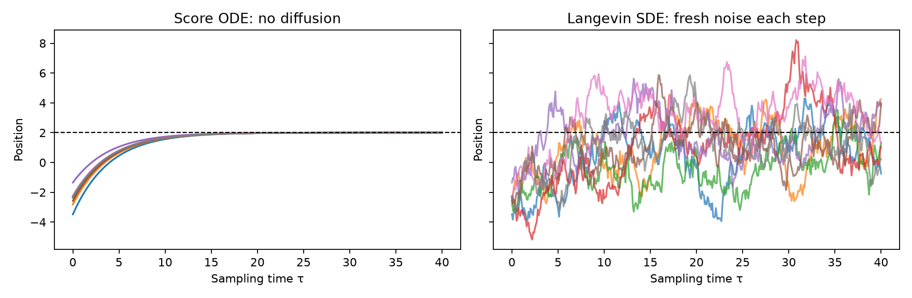
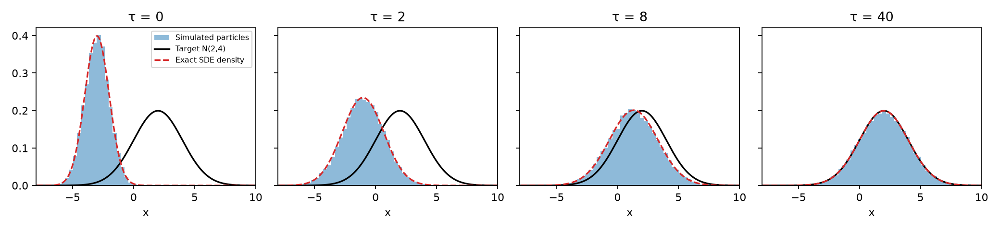
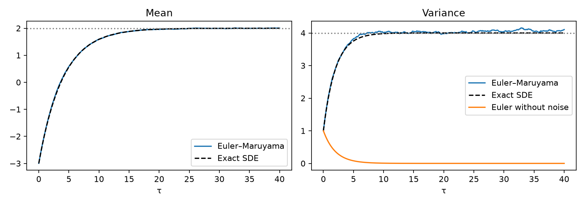
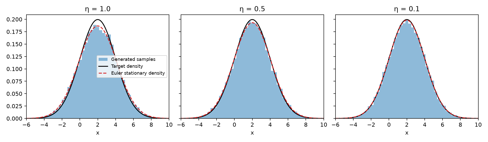

# 01 · Gaussian Langevin Sampling {.unnumbered}

## What this tutorial establishes

We want to generate observations from a specified probability density. One way is to initialize a collection of particles and repeatedly apply an update rule. The rule changes the distribution of the particles. To obtain the desired samples, we must choose dynamics whose distribution approaches the target, or whose finite-time transport reaches it.

This tutorial develops the first construction, **Langevin sampling**, entirely in one dimension. We use a non-standard Gaussian so that every part can be checked analytically:

$$\boxed{p(x)=\mathcal N(x;\mu,a^2),\qquad \mu=2,\quad a^2=4.}$$

Here $a$ is the target standard deviation. It is not the coefficient of Brownian noise in the SDE. We derive the score, substitute it into a supplied numerical solver, and compare dynamics with and without noise. We then verify stationarity and examine the generated density.

The sampling recipe is:

1. Choose an initial law and draw independent starting particles.
2. Evaluate the score at their current positions.
3. Apply a numerical update, with fresh noise when the dynamics is stochastic.
4. Repeat and compare the final particle distribution with the target.

This describes the iterative samplers studied here; it is not a claim that every sampling method requires an ODE or SDE. A Gaussian can be sampled directly, which gives us a useful reference for checking the dynamical sampler.

## 1. Separate the target, the initial law, and the evolving density

Write $p(x)$ for the fixed target density. We initialize

$$X_0\sim P_{\mathrm{init}}=\mathcal N(-3,1).$$

Let $q_\tau(x)$ denote the density of the particles after sampling time $\tau$. Initially $q_0=\mathcal N(-3,1)$; the aim is that $q_\tau$ approaches $p=\mathcal N(2,4)$.

The initial random draw and the Gaussian increments added later are different sources of randomness. We draw $X_0$ independently of the driving Brownian motion. Each particle has its own initial draw and independent subsequent increments.

For this Gaussian target, the score is defined everywhere and the Langevin dynamics is well-defined from every finite starting position. Initial and target supports need not coincide: a fixed starting position is also valid. Targets that vanish on regions or have restricted support require additional care concerning the domain of the score, boundaries, and accessibility.

## 2. Derive the score of the target

The density is

$$p(x)=\frac{1}{\sqrt{2\pi a^2}}\exp\left[-\frac{(x-\mu)^2}{2a^2}\right].$$

Take its logarithm and differentiate with respect to position:

$$\log p(x)=-\frac12\log(2\pi a^2)-\frac{(x-\mu)^2}{2a^2},$$

$$\boxed{s(x)=\frac{d}{dx}\log p(x)=-\frac{x-\mu}{a^2}.}$$

For our target,

$$\boxed{s(x)=-\frac{x-2}{4}.}$$

The score is positive to the left of 2, negative to its right, and zero at 2. It points toward the center. The scale $a^2$ determines how strongly it acts at a given displacement.

::: {.callout-note title="The score does not change with sampling time"}
The target is fixed, so the score is $s(x)$, not $s_\tau(x)$. At successive steps, we evaluate the same function at different positions. The sampling density $q_\tau$ changes, but the sampler uses the score of the **target** $p$, not the score of its current particle density $q_\tau$.
:::

## 3. First try: use the score as a deterministic velocity

Suppose particles follow the ODE

$$\frac{dx}{d\tau}=s(x)=-\frac{x-\mu}{a^2}.$$

Set $y=x-\mu$. Then $\dot y=-y/a^2$, so

$$\boxed{x(\tau)=\mu+(x_0-\mu)e^{-\tau/a^2}.}$$

This solution defines a flow: each initial position is mapped to a later position. Every trajectory approaches $\mu$. It does not retain the spread of the target Gaussian.

For an initial Gaussian $X_0\sim\mathcal N(m_0,V_0)$, an affine transformation preserves Gaussianity. Consequently,

$$q_\tau^{\mathrm{ODE}}=
\mathcal N\left(\mu+(m_0-\mu)e^{-\tau/a^2},\ V_0e^{-2\tau/a^2}\right).$$

The mean approaches the correct value, but the variance approaches zero. Thus matching the mean is insufficient to establish successful sampling.

### The supplied Euler update without diffusion

For step size $\eta>0$, explicit Euler gives

$$\boxed{x_{k+1}=x_k-\frac{\eta}{a^2}(x_k-\mu).}$$

For $0<\eta<a^2$, each update moves a fraction $\eta/a^2$ of the distance toward the center without overshooting. More generally, convergence of this numerical recursion requires $0<\eta<2a^2$. The continuous ODE has no numerical step-size restriction; this restriction belongs to its Euler approximation.

## 4. Add Brownian diffusion: the Langevin SDE

The Langevin dynamics for a fixed target is

$$\boxed{dX_\tau=s(X_\tau)\,d\tau+\sqrt2\,dW_\tau.}$$

A Brownian increment over an interval of length $\eta$ has distribution $\mathcal N(0,\eta)$ and is independent of the earlier increments. The score supplies the **drift**; the Brownian term supplies **diffusion**. Brownian noise is not another drift term.

Substitute the Gaussian score:

$$\boxed{dX_\tau=-\frac{X_\tau-\mu}{a^2}\,d\tau+\sqrt2\,dW_\tau.}$$

This is an Ornstein–Uhlenbeck process. Its drift pulls particles toward $\mu$, while its random increments spread them. The coefficient $\sqrt2$ is paired with the unit coefficient multiplying the score. Changing one without adjusting the other generally changes the stationary density.

### The supplied Euler–Maruyama update

We use the SDE counterpart of explicit Euler:

$$\boxed{x_{k+1}=x_k+\eta s(x_k)+\sqrt{2\eta}\,z_k,
\qquad z_k\overset{\mathrm{iid}}{\sim}\mathcal N(0,1).}$$

There is no need to derive stochastic calculus to implement this rule. The noise variance is $2\eta$ because the Brownian increment has variance $\eta$ and the SDE multiplies it by $\sqrt2$.

For the worked example,

$$\boxed{x_{k+1}=x_k-\frac{\eta}{4}(x_k-2)+\sqrt{2\eta}\,z_k.}$$

Removing the last term recovers the deterministic Euler update from Section 3. Starting all particles at 2 would leave them there without noise; with noise, their first positions would spread according to $\mathcal N(2,2\eta)$.



## 5. Why is the target stationary?

The density $q_\tau$ of the Langevin particles satisfies the supplied Fokker–Planck equation

$$\partial_\tau q_\tau=-\partial_x(sq_\tau)+\partial_x^2q_\tau.$$

The first term describes deterministic drift; the second describes Brownian spreading. Write this as a conservation equation:

$$\partial_\tau q_\tau=-\partial_x J_\tau,
\qquad J_\tau=sq_\tau-\partial_xq_\tau.$$

At the target density, the definition of the score gives

$$s(x)p(x)=\frac{p'(x)}{p(x)}p(x)=p'(x).$$

Therefore

$$J=sp-p'=0,\qquad \partial_\tau p=0.$$

So **the target density is stationary**: if $X_0$ already follows $p$, every later $X_\tau$ also follows $p$. For the Gaussian, we can check explicitly that

$$p'(x)=-\frac{x-\mu}{a^2}p(x),$$

which exactly cancels the score-driven flux. Individual particles still move at stationarity; it is their distribution that remains unchanged.

::: {.callout-caution title="Stationarity is not a convergence proof"}
Showing that the target is preserved when already reached does not show that every initial distribution approaches it. Convergence is a separate question. For this Gaussian example, we can verify it directly from the known solution, without a general ergodicity proof. Finite running time and numerical discretization introduce further approximation errors.
:::

## 6. The Gaussian solution shows the evolving density

For this SDE, the solution at any fixed time has the distributional representation

$$\boxed{X_\tau\overset{d}=\mu+e^{-\tau/a^2}(X_0-\mu)
+a\sqrt{1-e^{-2\tau/a^2}}\,Z,\qquad Z\sim\mathcal N(0,1),}$$

with $Z$ independent of $X_0$. The equality describes the law at a fixed time. Reusing one $Z$ at all times would not reproduce a Brownian trajectory. Appendix A derives the formula.

For $X_0\sim\mathcal N(m_0,V_0)$,

$$m_\tau=\mu+(m_0-\mu)e^{-\tau/a^2},$$

$$V_\tau=V_0e^{-2\tau/a^2}+a^2(1-e^{-2\tau/a^2}).$$

Hence $m_\tau\to\mu$ and $V_\tau\to a^2$. Because the distributions are Gaussian, this establishes convergence to the Gaussian target. More generally, the initial random term vanishes in probability for any initial probability law on $\mathbb R$, independently of the Brownian motion, giving weak convergence in this example.

With our numerical choices,

$$\boxed{q_\tau=\mathcal N\left(2-5e^{-\tau/4},\ 4-3e^{-\tau/2}\right).}$$





## 7. Implement sampling as a repeated update

The sampler carries a state, evaluates the same score function, and updates that state. The function below simulates independent particles in parallel. It does not call a Gaussian target sampler inside its update.

```python
import numpy as np

mu, a2 = 2.0, 4.0

def score(x):
    return -(x - mu) / a2

def sample_langevin(n=20_000, eta=0.1, final_time=40.0, seed=7):
    rng = np.random.default_rng(seed)
    x = rng.normal(loc=-3.0, scale=1.0, size=n)  # initial law
    steps = round(final_time / eta)
    if not np.isclose(steps * eta, final_time):
        raise ValueError("Choose final_time divisible by eta")
    for _ in range(steps):
        z = rng.standard_normal(n)             # fresh independent noise
        x = x + eta * score(x) + np.sqrt(2 * eta) * z
    return x
```

One terminal position per independently simulated particle supplies the final sample. Repeated positions along one trajectory are correlated and should not be treated as independent observations.

### A finite-step sampler is not the exact SDE

Center the numerical recursion at $\mu$ and define $A=1-\eta/a^2$:

$$x_{k+1}-\mu=A(x_k-\mu)+\sqrt{2\eta}\,z_k.$$

Its mean and variance obey

$$m_{k+1}-\mu=A(m_k-\mu),\qquad V_{k+1}=A^2V_k+2\eta.$$

For $|A|<1$, the stationary variance solves

$$V_\eta=A^2V_\eta+2\eta
\quad\Longrightarrow\quad
\boxed{V_\eta=\frac{a^2}{1-\eta/(2a^2)}.}$$

It exceeds $a^2$ at every fixed positive step size in the stable range. Thus an arbitrarily long numerical run does not remove discretization bias. For our target variance 4, step sizes $1,0.5,0.1$ give stationary variances approximately $4.5714,4.2667,4.0506$.

## 8. Compare the generated samples with the target

We simulate 20,000 independent particles to $\tau=40$ at each step size. The initial law is always $\mathcal N(-3,1)$. The simulations are reproducible using the [Python script](../materials/langevin-gaussian/simulate.py); it produces the figures and [numerical results](../materials/langevin-gaussian/results.json).



A density plot is a qualitative diagnostic. To quantify the discrepancy without choosing bins, compare the empirical CDF $\widehat F_M$ with the target CDF

$$F(x)=\Phi\left(\frac{x-\mu}{a}\right),\qquad
D_M=\sup_x|\widehat F_M(x)-F(x)|.$$

For sorted samples, compute

$$D_M=\max_i\left\{\frac{i}{M}-F(x_{(i)}),\ F(x_{(i)})-\frac{i-1}{M}\right\}.$$

Even exact samples have nonzero $D_M$. We therefore generate 20 independent reference batches of 20,000 exact target samples and compare their discrepancies with those of the numerical sampler.

| Step size | Sample mean | Sample variance | Empirical CDF error |
|---:|---:|---:|---:|
| 1 | 1.9983 | 4.5822 | 0.0185 |
| 0.5 | 2.0011 | 4.2788 | 0.0091 |
| 0.1 | 2.0042 | 4.1047 | 0.0068 |

The exact-sample reference has median $D_M=0.0067$ and observed range $[0.0031,0.0154]$ across the 20 batches. The target mean is 2 and variance is 4.

These are finite-sample diagnostics, not proofs of equality. Agreement of the mean can hide variance error. A numerical discrepancy within the exact-sample reference range does not establish zero discretization bias. Conversely, the analytic variance formula identifies that bias even when a particular empirical comparison is inconclusive. The reference range is descriptive, not a formal acceptance threshold.

## 9. How this connects to ODE and reverse-SDE generation

The common computational structure is an initial draw followed by repeated state updates. The governing equation determines which update is appropriate and what distribution the dynamics produces.

| Construction | Governing equation | Numerical update | Distributional objective |
|---|---|---|---|
| Deterministic transport | $\dot x=v(x,t)$ | Euler | Reach a prescribed endpoint distribution through a designed flow |
| Fixed-target Langevin | $dX=s(X)d\tau+\sqrt2dW$ | Euler–Maruyama | Approach a fixed target as sampling time increases |
| Reverse diffusion | Time-dependent reverse SDE | Euler–Maruyama or another stochastic solver | Follow a prescribed family of noisy densities back toward data |

An ODE sampler obtains its randomness from the initial law. An SDE sampler also receives fresh random increments. In either case, repeatedly applying an arbitrary rule is not enough: the rule must have the required transport or equilibrium property. Our score ODE is an explicit example of a perfectly well-defined dynamical system that fails to sample the desired target.

For comparison with the later course notes, let a forward diffusion be

$$dX_t=f(X_t,t)dt+g(t)dW_t,\qquad s_t(x)=\partial_x\log p_t(x).$$

Data time is $t=0$ and terminal noise time is $t=1$. Write $\tau=1-t$ and $Y_\tau=X_{1-\tau}$ for an increasing reverse clock. Under the standard regularity assumptions, its reverse dynamics is

$$dY_\tau=\left[-f(Y_\tau,1-\tau)+g(1-\tau)^2s_{1-\tau}(Y_\tau)\right]d\tau
+g(1-\tau)d\overline W_\tau.$$

Unlike fixed-target Langevin, this score changes with diffusion time. The reversed forward drift also appears. The corresponding probability-flow ODE has velocity

$$\frac{dy}{d\tau}=-f(y,1-\tau)+\frac12g(1-\tau)^2s_{1-\tau}(y).$$

Simply deleting Brownian noise from the reverse SDE would leave the wrong score coefficient. With the exact score and correct initial terminal law, the reverse SDE and probability-flow ODE share marginal densities, not individual trajectories. These relations are developed in [Song's SDE discussion](https://yang-song.net/blog/2021/score/), the [reverse-SDE notes](./40-reverse-sde-sampling.qmd), and the [probability-flow series](./probability-flow-ode.qmd).

The worked Gaussian example separates three questions students can now ask of a sampler: which law initializes the state, which equation governs its updates, and why those dynamics produce the intended distribution. When the score is unknown, [denoising score matching](./39-denoising-score-matching.qmd) supplies a way to estimate it. The numerical sampling procedure remains a separate part of the model.

## Appendix A. Deriving the Gaussian Langevin solution

This derivation is optional. Let $U_\tau=X_\tau-\mu$. Multiplying

$$dU_\tau=-\frac{U_\tau}{a^2}d\tau+\sqrt2dW_\tau$$

by the deterministic integrating factor $e^{\tau/a^2}$ cancels the drift:

$$d\left(e^{\tau/a^2}U_\tau\right)=\sqrt2e^{\tau/a^2}dW_\tau.$$

Integrating gives

$$X_\tau=\mu+e^{-\tau/a^2}(X_0-\mu)
+\sqrt2\int_0^\tau e^{-(\tau-u)/a^2}\,dW_u.$$

An Itô integral with a deterministic square-integrable integrand is a centered Gaussian. Its variance here is

$$2\int_0^\tau e^{-2(\tau-u)/a^2}du
=a^2\left(1-e^{-2\tau/a^2}\right).$$

Independence of the initial draw and Brownian motion makes the integral independent of $X_0$. This yields the fixed-time representation used in Section 6. The deterministic integrand is why no additional random coefficient calculation is needed here.

For this special Gaussian problem, the exact transition over an interval of length $\eta$ is also available:

$$X_{\tau+\eta}=\mu+e^{-\eta/a^2}(X_\tau-\mu)
+a\sqrt{1-e^{-2\eta/a^2}}\,Z,$$

where $Z$ is a fresh independent standard Gaussian. It preserves the target exactly at finite step sizes, unlike Euler–Maruyama. General targets usually do not provide such an exact transition, which is why learning to use and assess numerical updates is useful.
